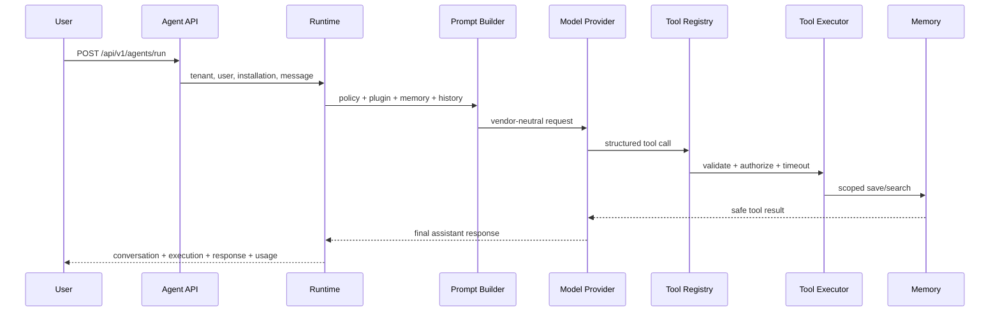

# Sprint 3.3 agent runtime

Sprint 3.3 turns enabled organization plugin installations into executable AI employees. The
runtime owns conversations, messages, model usage, tool activity, and scoped memory. Plugins and
models never receive Prisma, NestJS dependency injection, environment variables, credentials,
filesystem access, shell access, or unrestricted HTTP access.



## Local provider and demo

The `deterministic` provider is the default development/test provider. It performs no network
access and is not presented as an intelligent production model. An enabled plugin with the
`MEMORY` grant can demonstrate the complete tool loop:

```bash
curl http://localhost:4000/api/v1/agents/run \
  -H 'Authorization: Bearer <access-token>' \
  -H 'Content-Type: application/json' \
  -d '{"pluginInstallationId":"<uuid>","message":"Plan a 5-day Dubai trip for next month and remember that I prefer vegetarian food."}'
```

The provider requests `platform.memory.save`; the runtime checks installation state, plugin grants,
user RBAC, the tool allowlist, and the JSON Schema before executing. It then records the tool result
and asks the provider for the final response.

## Tool registration and security

Tools declare a globally unique name, version, JSON input schema, required RBAC permissions,
timeout, and sensitive paths. The initial safe tools are `platform.memory.save`,
`platform.memory.search`, and `platform.demo.echo`. Model output is untrusted. Unknown,
ungranted, invalid, or timed-out calls never reach a handler. Inputs and outputs persisted for
diagnostics are bounded and redact declared sensitive paths.

Memory scopes are `USER`, `CONVERSATION`, `PLUGIN`, and `ORGANIZATION`. Tenant and actor IDs come
only from authenticated runtime context, never model input. Memory uses relational text/key search;
vector search is intentionally deferred.

## APIs and dashboard

The API provides agent run, conversation list/detail/messages/archive, execution list/detail, and
memory CRUD/search endpoints. The dashboard exposes `/ai-employees`, `/conversations`, and
`/execution-history`, including safe tool summaries without chain-of-thought or raw internal JSON.

## Extension points and limitations

`LlmProvider` and `ModelProviderRegistry` are vendor-neutral boundaries for future OpenAI or Azure
adapters. Real provider credentials, OAuth-backed tools, vector memory, workflows, streaming,
background cancellation, and multi-agent orchestration are intentionally deferred. Pricing is
configuration-driven; when no model price is configured, token usage is stored and estimated cost
remains null.
