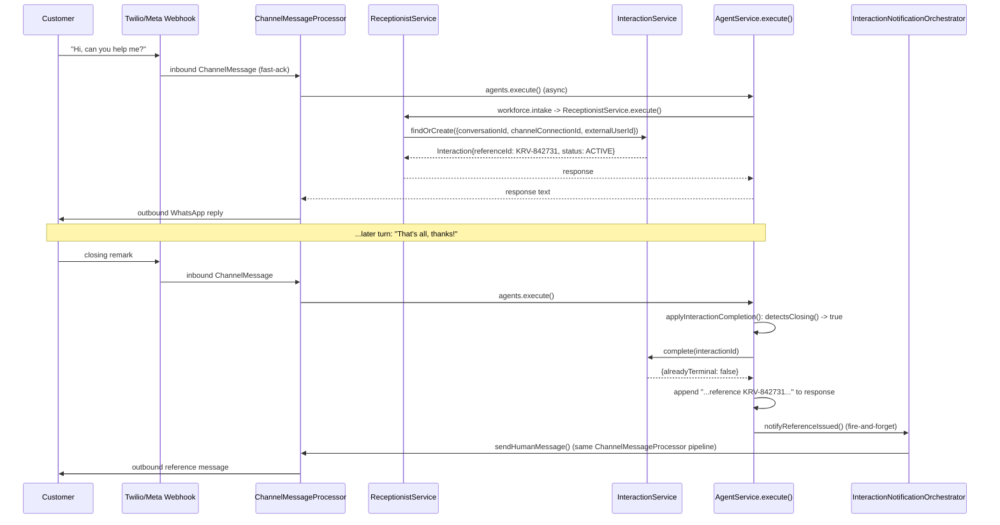
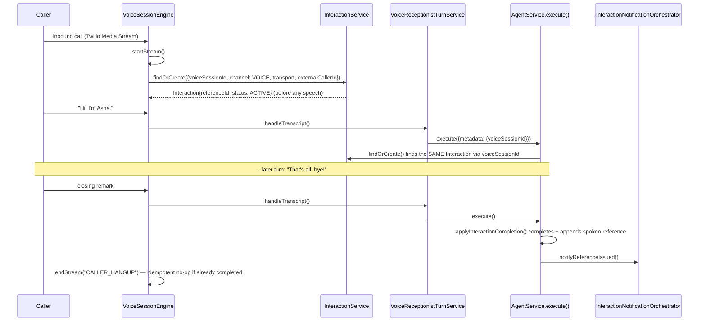

# Interaction & Notification Layer (Sprint 7.12)

A platform-wide, cross-channel case/reference system. Every customer interaction — web chat, WhatsApp
text, WhatsApp voice, PSTN voice — gets a persistent backend record and a short, voice-friendly,
customer-facing reference (e.g. `KRV-842731`) as soon as the first inbound activity happens, kept across
Receptionist routing, specialist handoff, tool calls, and workflows, and communicated back to the customer
at the end of the interaction — optionally also via SMS/email/WhatsApp.

This is a reusable capability, not a Travel-only feature: it lives in `apps/api/src/interaction/`, wired
centrally into `AgentService`/`ReceptionistService`/`VoiceSessionEngine`, and never duplicates
`Conversation`/`VoiceSession`/`ConversationMessage`/`AgentExecution` truth — it only tracks the case as a
whole.

## Architecture

```
User activity (web chat / WhatsApp / voice)
    |
    v
InteractionService.findOrCreate()  <-- the ONE channel-agnostic entry point
    |
    v
Interaction { referenceId, status, channel, conversationId?, voiceSessionId? }
    |
    +---------------------+
    |                      |
    v                      v
Conversation           VoiceSession
    |                      |
    +----------+-----------+
               |
               v
     AI Receptionist -> Specialist -> Tools -> Workflow
               |
               v
   AgentService.execute()'s applyInteractionCompletion()
   (closing-phrase detection -> InteractionCompletionService.complete())
               |
               v
   Reference appended to the response / spoken in voice
               |
               v
   InteractionNotificationOrchestrator.notifyReferenceIssued()
               |
      +--------+--------+
      |        |        |
      v        v        v
 WhatsApp     SMS     Email
```

### Sequence — WhatsApp text



### Sequence — Voice



## Database changes

New models (migration `20260906144114_sprint_7_12_interaction_domain`):

- **`Interaction`** — `id, organizationId, referenceId (unique), conversationId?, voiceSessionId?,
  channelConnectionId?, customerProfileId?, externalUserId?, phoneNumber?, email?, channel, transport?,
  status, entryAgentId?, currentAgentId?, startedAt, lastActivityAt, completedAt?, resolutionSummary?,
  referenceCommunicatedAt?, metadataJson`. `conversationId`/`voiceSessionId`/`channelConnectionId` are
  deliberately loose (non-FK) references — same convention as `VoiceSession.receptionistConversationId` —
  because an Interaction can exist before the Conversation/VoiceSession it will link to has been created.
- **`InteractionNotification`** — one row per delivery *attempt*: `id, interactionId, organizationId, type
  (EMAIL/SMS/WHATSAPP), destinationMasked, provider, status (PENDING/SENT/DELIVERED/FAILED/SKIPPED),
  providerMessageId?, failureReason?, requestedAt, sentAt?, deliveredAt?`.
- `InteractionStatus`: `OPEN, ACTIVE, WAITING, COMPLETED, FAILED, CANCELLED` (new rows start `ACTIVE`).
- `InteractionChannel`: `WEB_CHAT, WHATSAPP, VOICE`.

No existing table was modified. `Organization` gained one back-relation (`interactions`).

## Reference ID format

`KRV-842731` — configurable prefix (`INTERACTION_REFERENCE_PREFIX`, default `KRV`) and suffix length
(`INTERACTION_REFERENCE_LENGTH`, default 6), drawn from a 31-character voice-friendly charset
(`23456789ABCDEFGHJKMNPQRSTUVWXYZ` — excludes `0/O`, `1/I/L`, the classic ambiguous-when-spoken set).
Never derived from the row's UUID. Globally unique (`@unique` on `referenceId`, not scoped per
organization — STEP 44's own preference), with collision-retry-on-create (`ReferenceIdGenerator` +
`InteractionService.create`'s catch-P2002-and-retry loop, up to 5 attempts).

This is a second, purpose-built reference generator distinct from the pre-existing
`generateLeadReference()` (`conversation/conversation-completion.ts`, used for Travel/HR lead references)
— that one's plain base36 charset includes ambiguous characters, which is fine for a lead record nobody
reads back over the phone, but not acceptable here where voice-friendliness is an explicit requirement.

`normalizeReferenceId(raw, prefixLength)` handles user-typed/spoken variants ("krv 842731", "KRV842731",
"k r v - 8 4 2 7 3 1") by stripping non-alphanumerics, uppercasing, and reinserting the canonical dash —
used by both the admin API's reference-lookup route and the Receptionist's lookup tool.

`spokenReferenceId(referenceId)` renders `"K R V 8 4 2 7 3 1"` for TTS — used only when composing a voice
response; the stored value is never altered.

## Interaction lifecycle

`InteractionService.findOrCreate()` is the single, channel-agnostic entry point (rule: no per-channel
duplicate implementation). Resolution order: (1) an Interaction already linked to this exact
`conversationId`, (2) one already linked to this exact `voiceSessionId`, (3) the most recent *non-terminal*
Interaction for the same `(channelConnectionId, externalUserId)` identity — covers "customer messages
again before the Conversation even existed yet" and "specialist handoff dispatch reaches a different
conversation but the same channel identity" — otherwise (4) create a fresh one with a freshly generated
reference. Idempotent: safe to call on every inbound turn.

Completion (`InteractionCompletionService`) recognizes two concrete signals, since this codebase has no
generic "conversation ended" event (`ConversationStatus` is only `ACTIVE`/`ARCHIVED`):

1. **An explicit closing remark** in the customer's own text (`detectsClosing()`, English-only for now —
   same documented-limitation precedent as Sprint 6.6's Hinglish routing coverage), checked in
   `AgentService.execute()`'s `applyInteractionCompletion()` — the single choke point both
   Receptionist-routed and direct-employee results pass through (mirrors `applyChannelPolicy`'s own
   reasoning), so it applies uniformly to chat, WhatsApp, and voice-as-text alike.
2. **A voice call ending for a non-failure reason** (`VoiceSessionEngine.endStream()`) — a fallback for a
   call that simply hangs up without an explicit goodbye; idempotent against the same interaction if it
   was already completed by signal (1) mid-call.

`WorkflowExecutionService.markCompleted()` reaching `COMPLETED` is a natural third trigger point that is
**not wired in this sprint** — `InteractionCompletionService.complete(organizationId, interactionId,
summary)` is already the right shape for that hook to call later without further design work.

Completion is idempotent (`InteractionService.complete()`/`.fail()` return `{ alreadyTerminal: true }` for
an already-terminal row and skip re-firing the notification trigger — STEP 31).

## Web chat / WhatsApp integration

- **Receptionist-fronted conversations** (the primary architecture: Receptionist → specialist): the
  Interaction is created inside `ReceptionistService.execute()`, right after its own conversation
  resolution — this is the TRUE first-contact point, since a `workforce.intake` plugin's execution returns
  from `AgentService.executeTraced()` before that method's own conversation-resolution code ever runs.
- **Direct employee execution** (a dashboard chat or a specialist handoff dispatch pointed straight at a
  specific plugin): the Interaction is created/found inside `AgentService.executeTraced()`, right after
  its conversation is resolved. A handoff dispatch reaching this point finds the SAME Interaction the
  Receptionist already created, via the shared channel identity — never a duplicate.
- Both hooks call the identical `InteractionService.findOrCreate()`.

## Voice integration

`VoiceSessionEngine.startStream()` creates/links the Interaction immediately (before any transcript turn),
using the `VoiceSession`'s own `channelConnectionId`/`transport`/`externalCallerId` — satisfying "even a
call that rings and hangs up before speaking deserves a case record." The first transcript turn (via
`VoiceReceptionistTurnService.handleTranscript()` → `AgentService.execute()`, which already carries
`metadata.voiceSessionId`) finds and reuses this SAME Interaction rather than creating a second one.

The voice gateway never generates its own unrelated case/reference — everything flows through
`InteractionService`.

## Agent/handoff/tool/workflow integration

- Agent handoff does **not** create a new Interaction — `currentAgentId` is updated on every turn
  (`InteractionService.setCurrentAgent()`), preserving `entryAgentId` and `referenceId` unchanged.
- Tool calls run through the existing `ToolRegistry`/`AgentExecution` pipeline untouched; the Interaction
  is resolved once per turn at the `AgentService.execute()` level, not per tool call.
- `WorkflowExecution` continues under the same Conversation, so the same Interaction (found by
  `conversationId`) covers it automatically — no separate wiring needed for the common case.

## Reference communication

Communicated at completion, via a small, deterministic template appended to the ALREADY-composed agent
response (`AgentService.execute()`'s `applyInteractionCompletion()`), not literal freeform LLM prompt
improvisation — this reaches every employee/plugin uniformly without touching each one's own prompt-
building code. Guarded against double-send by `InteractionService.claimReferenceCommunication()` — an
atomic conditional update (`referenceCommunicatedAt IS NULL`) that only ever succeeds once per interaction.

- **Chat/WhatsApp**: `"You're all set — I've saved this under reference KRV-842731. If you contact us
  again, just share that reference."` appended to the response text.
- **Voice**: `"Before we finish, your reference is K R V 8 4 2 7 3 1."` — uses `spokenReferenceId()` so
  the realtime provider pronounces each character rather than trying to read "KRV" as a word.

## Notification architecture

`InteractionNotificationOrchestrator` is the ONLY place that sends a reference notification — never
directly from a chat/voice controller. Responsibilities: resolve available destinations, apply the
channel-preference policy below, avoid duplicates (one attempt per `(interactionId, type)` — a second
`notifyReferenceIssued()` call for an already-PENDING/SENT/DELIVERED type is a no-op), invoke the right
provider, and persist every attempt. A notification failure never blocks or rolls back interaction
completion — it is called strictly *after* the interaction is already marked complete, and every internal
step is wrapped so an exception here can never propagate.

### Channel preference policy (STEP 17)

| Interaction origin | Attempts |
|---|---|
| WhatsApp (or voice over a WhatsApp-identified caller) | WhatsApp (if a WhatsApp-linked conversation exists), plus email if known |
| Voice (non-WhatsApp) | SMS if a phone number is known, plus email if known |
| Web chat | Email if known, plus SMS if a phone number is known |

Never every channel by default — only what the origin and known contact details justify.

### SMS

`SmsProvider` interface (`send(input) -> { provider, status, messageId, error, retryable }`).
`MockSmsProvider` (default, zero credentials, `simulateNextFailure("transient"|"permanent")` for
deterministic test scripting) and `TwilioSmsProvider` (real Twilio Messages API call, structurally
parallel to the existing `TwilioClient.sendWhatsAppMessage` but a distinct endpoint — plain SMS never
carries the `whatsapp:` address prefix). `TwilioSmsProvider.isConfigured()` gates real use; the
orchestrator always falls back to the mock when it returns false. One immediate retry on a `retryable`
failure (STEP 32) — not a scheduled backoff job (see Known limitations below).

### Email

Reuses the existing `EmailService` (`notifications/email.service.ts`) unchanged — the same one password
reset and Travel ticket delivery already use. `EmailNotConfiguredError` is caught and recorded as a
`FAILED` notification with reason `EMAIL_NOT_CONFIGURED`, never silently skipped-and-forgotten.

### WhatsApp

Reuses the existing `ChannelMessageProcessor.sendHumanMessage()` (the same pipeline Sprint 6.7's
human-takeover replies already go through) — no second Twilio/Meta implementation. Resolved lazily via
`ModuleRef` against a small `WHATSAPP_SENDER` token (`interaction/whatsapp-sender.types.ts`), not a direct
constructor dependency: `ChannelModule` transitively imports `AgentModule`, and `AgentService` optionally
injects `InteractionService` back, which would otherwise be a genuine circular module dependency. This
mirrors `AgentService.getReceptionistRuntime()`/`getChatDelegationTrigger()`'s own established pattern for
the identical class of problem.

### Templates (STEP 20)

Pure, testable render functions (`notification-templates.ts`) — `REFERENCE_EMAIL`, `REFERENCE_SMS`,
`REFERENCE_WHATSAPP`. No secrets interpolated; no assumption that a customer name is known.

### Delivery status

`PENDING -> SENT -> DELIVERED` or `PENDING -> FAILED`/`SKIPPED`. Mock/SMTP/current WhatsApp reuse never
fabricate `DELIVERED` — `SENT` is the terminal success state until a real delivery-callback integration
exists (Twilio's own WhatsApp/SMS status-callback infrastructure already exists in `channels/` for the
main outbound pipeline and could be extended to update `InteractionNotification.deliveredAt`, but that
wiring is not done in this sprint).

## Reference lookup & resume

`InteractionReferenceLookupService.lookup(organizationId, rawReferenceId)` — tenant-scoped (never accepts a
bare reference with no organization context), case/format-insensitive via `normalizeReferenceId()`. Returns
status, channel, entry/current agent, and a summary sourced from the EXISTING `ConversationSummary` table
when one exists for the linked conversation (never a raw transcript replay), falling back to the
Interaction's own `resolutionSummary`.

Registered as a real `ToolRegistry` tool — `platform.interaction.lookup_reference` — so the AI Receptionist
recognizes "my reference is KRV-842731" through the same tool-calling pipeline every other employee tool
already uses, not brittle regex-only routing. Tenant-scoped via `ToolExecutionContext.organizationId`.

## Admin API

Mirrors the Call History API's exact RBAC/pagination convention (`agents.conversations.read` — no new
permission string needed, since this is a cross-channel read endpoint with no more-sensitive sibling the
way voice transcripts had):

| Route | Notes |
|---|---|
| `GET /api/v1/interactions` | Paginated, newest-first. Filters: `status`, `channel`, `agentId`, `dateFrom`, `dateTo` |
| `GET /api/v1/interactions/:id` | Single interaction summary |
| `GET /api/v1/interactions/reference/:referenceId` | Same summary, looked up by (normalized) reference |
| `GET /api/v1/interactions/:id/notifications` | Full delivery-attempt history for that interaction |

`phoneNumber`/`email` are masked in every response (`+91******1193`, `kr*****@example.com`) — the raw
values are never returned by this API.

## Dashboard

Minimal "Interactions" section (`apps/dashboard/src/features/interactions/`) — not a CRM: a filterable
list (reference, started, channel, masked contact, status, whether the reference was communicated) and a
detail view (summary, conversation/voice-call links, notification delivery history). Not a duplicate
transcript viewer — links out to the existing Voice Calls detail page for voice interactions.

## Security & privacy

- A reference ID is an **identifier, never an authentication secret** — knowing it is not sufficient to
  access another tenant's data. Every lookup path (admin API, the Receptionist tool) requires an
  authenticated/tenant-scoped caller and always filters by `organizationId` first.
- `phoneNumber`/`email` are masked in the admin API and in `InteractionNotification.destinationMasked`
  (written once at send time — the unmasked destination is read fresh from Interaction/Conversation
  identity fields and never persisted a second time).
- No secrets, raw provider tokens, full email addresses, full phone numbers, or transcript text appear in
  any structured log line this sprint added.

## Mock mode

Zero paid credentials required for any test or local development: `MockSmsProvider` is the default SMS
provider; `EmailService` degrades to a recorded `FAILED`/`EMAIL_NOT_CONFIGURED` notification (never a
crash) when SMTP is unset; WhatsApp reference delivery reuses the existing WhatsApp mock-mode conventions
already established for Sprint 6.7's channel runtime. `REFERENCE_NOTIFICATION_ENABLED`/
`REFERENCE_EMAIL_ENABLED`/`REFERENCE_SMS_ENABLED`/`REFERENCE_WHATSAPP_ENABLED` gate whether the
orchestrator attempts a given channel at all — all default `true`, since the mock providers work with no
configuration.

## Configuration

| Variable | Default | Notes |
|---|---|---|
| `INTERACTION_REFERENCE_PREFIX` | `KRV` | One global prefix — no per-organization config exists yet (see Known limitations) |
| `INTERACTION_REFERENCE_LENGTH` | `6` | Suffix length drawn from the voice-friendly charset |
| `REFERENCE_NOTIFICATION_ENABLED` | `true` | Master switch |
| `REFERENCE_EMAIL_ENABLED` / `REFERENCE_SMS_ENABLED` / `REFERENCE_WHATSAPP_ENABLED` | `true` | Per-channel switches |
| `TWILIO_ACCOUNT_SID` / `TWILIO_AUTH_TOKEN` / `TWILIO_SMS_FROM_NUMBER` | unset | Real `TwilioSmsProvider` credentials — a standalone pair; the WhatsApp channel runtime resolves its own Twilio credentials per-`ChannelConnection`, not from these |

## Known limitations (honest scope cuts)

- **Per-tenant reference prefix**: not implemented — no existing arbitrary org-settings table fits without
  a schema stretch (`OrganizationSetting` has fixed columns only; `FeatureFlag.value` would be a
  repurposing, not a clean fit). One global env-configured prefix for now.
- **Scheduled/backoff notification retry**: email/SMS sends are synchronous with exactly one immediate
  retry on a transient SMS failure — not a durable, scheduled-backoff queue. The existing
  `QueueMessage`/`QueueCategory.NOTIFICATION_JOBS` scaffolding (`apps/api/src/queue/`) already reserves a
  category for exactly this, but it has zero real consumers anywhere in the codebase today (confirmed by
  inspection) — adopting genuinely untested infrastructure for a production delivery path was judged
  riskier than the proven poll-and-claim pattern this sprint's WhatsApp path already reuses via
  `ChannelMessageProcessor`. WhatsApp reference notifications DO get real retry, for free, through that
  existing pipeline.
- **WorkflowExecution-completion hook**: not wired (see Lifecycle above) — a clean follow-up, not a design
  gap, since `InteractionCompletionService.complete()` already has the right signature.
- **Real delivery-status callbacks** (SMS/WhatsApp `DELIVERED`): prepared for architecturally (the status
  enum has `DELIVERED`; Twilio's existing status-callback infrastructure could be extended) but not wired.
- **Closing-phrase detection is English-only.**
- This is **not a compliance product** — reference-ID masking and tenant isolation are implemented and
  tested, but no claim of GDPR/CCPA/telephony-consent compliance is made.
