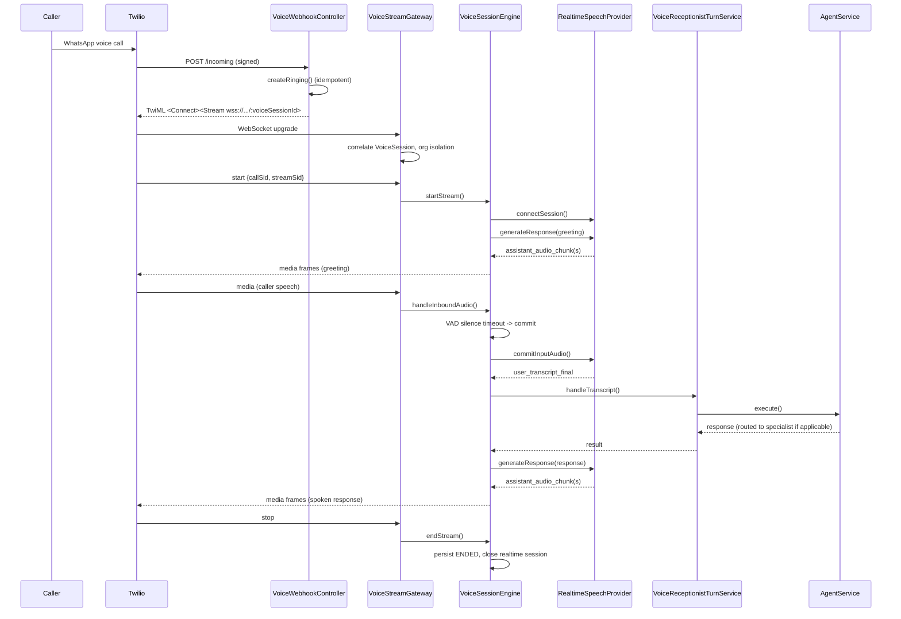

# Real-Time Voice Calling (Sprint 7)

Voice is a **channel**, not a separate product. A phone call is transport + realtime speech; the AI
Receptionist, specialist routing, tools, memory, approvals, and conversation history are the exact same
architecture WhatsApp text and web chat already use. No voice-specific agent logic exists anywhere in this
system — every caller turn goes through the same `AgentService.execute()` entry point as everything else.

## Architecture

```
Twilio (Voice + Media Streams)
   |
   | signed webhook: POST /channels/twilio/voice/:channelId/incoming
   v
VoiceWebhookController          — thin: verify, create/retrieve VoiceSession, return TwiML
   |
   | <Connect><Stream url="wss://.../channels/twilio/voice/stream/:voiceSessionId"/></Connect>
   v
VoiceStreamGateway               — raw `ws` attached to the HTTP server via HttpAdapterHost
   |                               (NOT @nestjs/websockets — Twilio speaks plain WS/JSON, not socket.io)
   | connected/start/media/mark/stop
   v
VoiceStreamConnectionHandler     — per-connection protocol handling, schema validation, CallSid
   |                               correlation, message-size + rate bounds (unit-tested in isolation)
   v
VoiceSessionEngine                — the ONE orchestration layer: session lifecycle, VAD-based turn
   |                                detection, backpressure-bounded outbound audio, barge-in, metrics
   |
   +--> RealtimeSpeechProvider (mock today; Twilio-agnostic interface)
   |        appendInputAudio / commitInputAudio / cancelResponse / generateResponse
   |        events: user_transcript_final, assistant_audio_chunk, ...
   |
   +--> VoiceReceptionistTurnService.handleTranscript()
            -> AgentService.execute()             <-- SAME entry point as WhatsApp text / web chat
                 -> ReceptionistService (if the target plugin has "workforce.intake")
                      -> ReceptionistRoutingService -> specialist handoff (Travel, HR, ...)
                 -> composeChannelResponse(response, "VOICE")   <-- markdown/URLs stripped for speech
```

## Call lifecycle

`VoiceSession` (Prisma model) states: `CREATED -> RINGING -> CONNECTING -> ACTIVE -> {INTERRUPTED <->
ACTIVE} -> ENDING -> ENDED | FAILED`. Every transition is a single atomic `updateMany` gated by the
current status (the same conditional-update idiom `ChannelMessageProcessor` already uses), so out-of-order
or duplicate provider events can't corrupt state, and repeated `stop`/`end` events are harmless no-ops
(idempotent).

- **Inbound webhook**: `VoiceSessionService.createRinging()` creates the row (`RINGING`) before any
  receptionist conversation exists — the `@@unique([organizationId, provider, providerCallId])`
  constraint makes a retried webhook delivery idempotent (P2002 → fetch the existing row).
- **Media stream connects**: `markStreamStarted()` (→ `CONNECTING`), then `markActive()` (→ `ACTIVE`,
  `answeredAt` set) once the realtime provider session is live.
- **First turn**: the receptionist conversation doesn't exist yet — `VoiceReceptionistTurnService` calls
  `AgentService.execute()` with `conversationId` omitted (exactly like a brand-new WhatsApp conversation)
  and links the resulting conversation back onto the `VoiceSession` afterward
  (`linkConversation`, idempotent — never overwrites an existing link).
- **Termination**: `endStream()` closes the realtime session, persists the terminal status +
  `terminationReason`, and is safe to call twice (idle timeout, max-duration timeout, caller hangup, and
  WebSocket disconnect all funnel through the same idempotent path).

## Barge-in / interruption

When a caller starts speaking while the agent's response is still playing:

1. `sessions.interrupt()` — `ACTIVE -> INTERRUPTED` (durable, auditable).
2. `realtimeSession.cancelResponse()` — invalidates the in-flight generation via a token check, so any
   pending audio chunks/transcript events for the cancelled response never fire (no overlapping replies).
3. The outbound audio queue is cleared and a transport `clear` frame is sent immediately.
4. `sessions.resume()` — `INTERRUPTED -> ACTIVE` — and the new turn is processed normally.

Covered by a dedicated engine test (`voice-session.engine.spec.ts`) using a slow, multi-chunk mock
response deliberately kept "in flight" so the interruption is genuine, not a same-tick race.

## Turn detection

Provider-neutral, energy-based VAD lives in `VoiceSessionEngine` itself (not hardwired to any vendor):
RMS of each inbound PCM16 frame vs. `speechStartThreshold`; once speech is detected, a
`speechEndSilenceMs` (700ms default) silence timer commits the turn. `forceEndOfTurn()` is a separate,
explicit-commit path (used by the simulator and any future push-to-talk UI) — independent of the VAD
state, matching STEP 14's "explicit commit" mode.

## Audio codec boundary

Everything above the transport layer works in `NormalizedAudioFrame` (16-bit PCM). Twilio's 8kHz mu-law is
converted at the edge only (`voice-audio-codec.ts` — a hand-implemented ITU-T G.711 codec, no external
dependency) so mu-law never leaks into the engine or realtime provider.

## Realtime provider abstraction

`RealtimeSpeechProvider` supports both a speech-to-speech vendor and an STT→LLM→TTS pipeline identically —
application code never knows which. **MockRealtimeVoiceProvider** (`VOICE_REALTIME_PROVIDER=mock`, the
default) requires no credentials and exercises the entire real pipeline; only the external speech
transformation is faked. `simulateUserUtterance()` is the one mock-only hook tests/the simulator use to
script a caller line without synthesizing real audio.

Both `VoiceTransportProvider` (Twilio today) and `RealtimeSpeechProvider` (mock today) are bound behind DI
tokens (`VOICE_TRANSPORT_PROVIDER`, `VOICE_REALTIME_SPEECH_PROVIDER`) — every consumer depends on the
interface, never the concrete class, so either is swappable without touching the controller, gateway, or
engine.

## Security

- Twilio signature verification reuses `verifyTwilioSignature`/`resolveTwilioCredentials` from the
  existing WhatsApp channel runtime (env-var override → encrypted per-`ChannelConnection` secret fallback)
  — no new credential-handling code path.
- The WebSocket endpoint is not "secure by obscurity": every connection is correlated to an exact,
  unguessable `VoiceSession` UUID, re-verified against `ChannelConnection.voiceEnabled`/`status`, and the
  Twilio `start` event's CallSid is cross-checked against the session's own `providerCallId`
  (`CALL_SID_MISMATCH` closes the socket otherwise).
- Bounded message size (64KB) and a per-connection rate limit (100 msg/s) reject abuse; malformed/unknown
  events are rejected via strict schema parsing, not silently ignored.
- Voice requires two independent flags: the global `RECEPTIONIST_VOICE_ENABLED` env var AND
  `ChannelConnection.voiceEnabled` — a channel is never accidentally voice-enabled.

## Structured logging (Sprint 7.11 STEP 3)

Every voice log site uses `voiceLogContext()` (`voice-log-context.ts`) instead of ad-hoc string logs, to
match the existing object-log convention used elsewhere in the codebase
(`this.logger.warn({ event: "X", ...fields })`). The schema (`VoiceLogContext`):

`requestId, organizationId, channelId, voiceSessionId, conversationId, agentId, activeAgentId, provider,
transport, providerCallId, providerStreamId, event, sequenceNumber, latencyMs, errorCode` — none are
required, since not every log site has all of them yet (e.g. a webhook-time log has no `voiceSessionId`).

Guarantees, enforced by `voiceLogContext()` itself and covered by `voice-log-context.spec.ts`:

- Any key matching `/token|secret|password|authorization|credential|apikey/i` is dropped entirely — not
  redacted-with-a-placeholder, simply never present in the emitted object — even if a caller passes one by
  mistake. Twilio Auth Tokens and provider secrets can never reach a log line through this path.
- Raw audio and full transcripts are not redacted at runtime — they are **structurally excluded**: the
  `VoiceLogContext` TypeScript type has no field for either, so passing one is a compile error, not a
  runtime redaction that could regress silently.
- Oversized string fields (e.g. a long `errorCode`) are truncated at 200 characters with a `…(truncated)`
  suffix rather than logged in full.
- `undefined` fields are omitted rather than logged as null/undefined noise.

## Metrics (Sprint 7.11 STEP 11)

`VoiceMetricsService` (in-memory counters/histograms, snapshot-based — no `prom-client` dependency, matching
the existing repo convention) tracks, among others:

- `voice_calls_completed_total` / `voice_calls_failed_total` — split by `FAILURE_TERMINATION_REASONS`
  (`voice-session.engine.ts`): `STREAM_DISCONNECTED`, `PROVIDER_ERROR`, `AGENT_EXECUTION_ERROR`,
  `REALTIME_PROVIDER_ERROR`, `AUTHENTICATION_ERROR`, `AUDIO_CODEC_ERROR`, `INVALID_EVENT` count as failures;
  `MAX_DURATION_EXCEEDED` and a normal caller hangup do not — hitting a policy cap isn't a failure.
- `voice_audio_frames_dropped_total` — incremented on every outbound-queue overflow.
- Histograms: `voice_response_latency_ms`, `voice_first_audio_latency_ms`, `voice_call_duration_seconds`,
  `voice_agent_execution_latency_ms`, `voice_speech_to_transcript_latency_ms`.

Each histogram is populated from real timestamps captured during the call — first inbound audio, speech
start/end (VAD), final transcript, agent execution start/finish, first outbound audio chunk of a response,
response finished — not estimated. No latency *targets* are asserted anywhere in the test suite; only that
the calculation itself is correct, since no target has actually been measured against a real provider yet.

## Call History API (Sprint 7.11 STEP 4)

Read-only, tenant-scoped, RBAC-protected — mirrors the existing Channels API's pagination/RBAC conventions
exactly (`voice-call-history.controller.ts`, `.service.ts`, `.dto.ts`):

| Route | Permission | Notes |
|---|---|---|
| `GET /api/v1/voice/sessions` | `channel.message.read` | Paginated, newest-first. Filters: `status`, `transport`, `channelConnectionId`, `agentId`, `dateFrom`, `dateTo` |
| `GET /api/v1/voice/sessions/:id` | `channel.message.read` | Session summary + its `ReceptionistHandoff` chain |
| `GET /api/v1/voice/sessions/:id/transcript` | `channel.voice.transcript.read` | Paginated, sequence-ordered transcript segments — a dedicated, more-sensitive permission on top of `channel.message.read` |

- `externalCallerId` is masked by default (`VOICE_MASK_CALLER_ID=true`) before it ever leaves the service —
  the raw value stays in Postgres (the provider needs it to route/re-dial) but is not exposed by the API
  unless a deployment explicitly opts out.
- Tenant isolation is enforced by scoping every query to `organizationId`, including the `agentId` filter
  (resolved via a separate `Conversation` lookup scoped to the same organization first). Covered by a real
  Postgres, two-organization e2e test (`voice-call-history.tenant-isolation.e2e.spec.ts`) — never returns,
  fetches, or transcripts another tenant's session.
- No raw audio is exposed by any endpoint — none is ever persisted in the first place.

## Admin UI (Sprint 7.11 STEP 5/6)

A minimal "Voice Calls" section in the dashboard (`apps/dashboard/src/features/voice-calls/`) — not a full
contact-center product:

- **List** (`/voice-calls`): start time, duration, masked caller, status, transport, provider, with
  status/transport filters and pagination. Linkable from a channel's detail page
  (`/voice-calls?channelConnectionId=...`).
- **Detail** (`/voice-calls/:id`): summary (duration, transport, provider, termination reason, routing/
  specialist-response latency), the agent handoff chain (built directly from persisted
  `ReceptionistHandoff` rows — no invented event types), and the full ordered transcript.
- The Channels detail page shows a small "Voice" card (`Voice calling: Enabled/Disabled`, from
  `ChannelConnection.voiceEnabled`) linking into the call history filtered to that channel.
- No raw provider credentials are ever rendered. No raw (unmasked) caller ID by default.

## Provider contract readiness (Sprint 7.11 STEP 15)

`runRealtimeSpeechProviderContract()` (`realtime-speech-provider.contract.spec.ts`) is a reusable contract
test suite — connect, input audio, speech-started, transcript-final, assistant audio, cancel, close, error
propagation — that any future `RealtimeSpeechProvider` implementation (OpenAI/Azure/Google realtime, etc.)
can be run through to prove it satisfies exactly what `VoiceSessionEngine` depends on. Today it runs only
against `MockRealtimeVoiceProvider`, since that is the only implementation that exists. Adding a real
provider is expected to be: implement `RealtimeSpeechProvider`, run it through this contract suite, bind it
in `voice.module.ts`, add its name to `implementedProviders` in the `VOICE_REALTIME_SPEECH_PROVIDER`
factory — **not** a `VoiceSessionEngine` rewrite.

## Failure taxonomy (Sprint 7.11 STEP 10)

Errors are normalized through `VoiceError`'s `VoiceErrorCode` union (`voice.types.ts`), predating 7.11 and
reused rather than duplicated: `VOICE_PROVIDER_ERROR`, `REALTIME_PROVIDER_ERROR`, `AUDIO_CODEC_ERROR`,
`AGENT_EXECUTION_ERROR`, `TOOL_EXECUTION_ERROR`, `STREAM_DISCONNECTED`, `AUTHENTICATION_ERROR`,
`SESSION_NOT_FOUND`, `INVALID_EVENT`, `TIMEOUT`. These map consistently to: `voiceLogContext()` log events,
`VoiceSession.status`/`terminationReason` on persistence, and `voice_calls_failed_total` via
`FAILURE_TERMINATION_REASONS`. Queue overflow is logged as `VOICE_QUEUE_OVERFLOW` and counted separately
(`voice_audio_frames_dropped_total`) rather than added as an eleventh error code, since it is a recoverable
per-frame event, not a session-ending error. There is no dedicated "invalid state" code distinct from
`SESSION_NOT_FOUND`/`STREAM_DISCONNECTED` — operating on a session that has already ended surfaces as
`SESSION_NOT_FOUND` in practice, since ended sessions are removed from the in-memory registry
(`voice-session-hardening.spec.ts` covers this for every termination path). No new, redundant code was
introduced where an existing one already covers the case.

## Privacy & Retention (Sprint 7.11 STEP 14)

This section documents the current data-handling behavior. **It is not a claim of legal or regulatory
compliance** — GDPR/CCPA/telephony-recording-consent obligations depend on jurisdiction and deployment and
must be reviewed separately by the deploying organization.

**What is persisted:**

| Data | Table | Contains raw text? |
|---|---|---|
| Call metadata (times, status, transport, provider, termination reason, latencies) | `VoiceSession` | No |
| Caller identifier as reported by the telephony provider | `VoiceSession.externalCallerId` | Yes — raw phone/identifier, needed to route/re-dial |
| Per-utterance transcript (partial + final) | `VoiceTranscriptSegment` | Yes — full utterance text, for call replay/QA |
| Conversation truth (the same text, via the normal text pipeline) | `ConversationMessage` | Yes |

**What is never persisted:** raw audio, in any form, anywhere. `MockRealtimeVoiceProvider` never
serializes audio to disk or DB; there is no code path that writes an audio buffer to Postgres. This is a
structural property of the current design, not a config toggle — enabling a real provider later does not
change it, since `VoiceSessionEngine` never receives audio bytes it could persist even if it wanted to
gate that with a flag.

**Config points prepared for a future retention job** (`resolveVoicePrivacyConfig()`, `voice-config.ts`):
`VOICE_TRANSCRIPT_RETENTION_DAYS` (default 90) and `VOICE_EVENT_RETENTION_DAYS` (default 90) are read and
validated today, but **no scheduled deletion job exists yet** — they are a config surface a future
retention job can consume without a schema or call-site change, not an enforced policy. Until that job
ships, deleting old transcripts/sessions is a manual operational step (direct SQL against
`voice_transcript_segments`/`voice_sessions`, scoped by `started_at`/`created_at`), and structured log
events' retention is whatever the deployment's own log platform is configured to keep.

**Caller ID masking**: `VOICE_MASK_CALLER_ID` (default `true`) controls whether the Call History API and
admin UI expose `externalCallerId` masked (`+*******1234`) or raw. The raw value always stays in Postgres
regardless of this flag — it only controls what is exposed through the read API, not what is stored.

**Deletion implications**: deleting a `VoiceSession` row cascades to its `VoiceTranscriptSegment` rows
(`onDelete: Cascade` in the schema) but does **not** touch the corresponding `ConversationMessage` rows in
the normal conversation history, nor any structured log lines already shipped to the deployment's log
platform — a full "forget this caller" operation needs to account for all three independently.

## Configuration

| Variable | Default | Notes |
|---|---|---|
| `RECEPTIONIST_VOICE_ENABLED` | `false` | Master flag (pre-existing from the voice domain groundwork) |
| `VOICE_PROVIDER` | `twilio` | Transport provider name |
| `VOICE_REALTIME_PROVIDER` | `mock` | `mock` requires no credentials; any other value fails fast at boot |
| `VOICE_PUBLIC_WS_URL` | derived from `API_PUBLIC_URL` | Optional override for the TwiML `<Stream>` URL |
| `VOICE_MAX_CALL_DURATION_SECONDS` | `1800` | Hard cap per call |
| `VOICE_IDLE_TIMEOUT_SECONDS` | `30` | No activity → call ends |
| `VOICE_MAX_CONCURRENT_SESSIONS` | `50` | New streams rejected past this |
| `VOICE_ALLOW_MOCK_IN_PRODUCTION` | `false` | Must be explicitly set to run the mock provider in production (see Production config validation below) |
| `VOICE_TRANSCRIPT_RETENTION_DAYS` | `90` | Retention config point — see Privacy & Retention |
| `VOICE_EVENT_RETENTION_DAYS` | `90` | Retention config point — see Privacy & Retention |
| `VOICE_MASK_CALLER_ID` | `true` | Whether the Call History API/admin UI mask `externalCallerId` |

Missing real Twilio/realtime credentials never crash the app — only explicitly requesting a non-mock
realtime provider without an implementation fails fast, with a clear error, at module-init time.

## Production config validation (Sprint 7.11 STEP 17)

`validateVoiceRealtimeProviderSelection()` (`voice-config.ts`) runs once at module-init time
(`voice.module.ts`'s `VOICE_REALTIME_SPEECH_PROVIDER` factory) and enforces, in both directions:

- **Mock never runs silently in production.** `VOICE_REALTIME_PROVIDER=mock` with `productionLike: true`
  throws `VOICE_MOCK_PROVIDER_NOT_ALLOWED_IN_PRODUCTION` unless `VOICE_ALLOW_MOCK_IN_PRODUCTION=true` is
  set — a deliberate, supervised opt-in for a production smoke test, not a default.
- **An unimplemented real provider never silently falls back to mock**, in any environment. Requesting
  `VOICE_REALTIME_PROVIDER=openai-realtime` (or any name not in `implementedProviders`) throws
  `VOICE_REALTIME_PROVIDER_UNSUPPORTED` immediately — the app never starts with a half-configured voice
  stack that would silently answer calls with the wrong provider.
- Development/test keep the zero-credential mock path working with no extra configuration — only
  `productionLike: true` triggers either check.

Covered by `voice-config.spec.ts`.

## Testing without any paid service

```bash
# Unit tests — no database, no network
npx vitest run src/voice

# Local simulator — prints a full call transcript (needs TEST_DATABASE_URL, no Twilio/realtime credentials)
TEST_DATABASE_URL=postgresql://... npx vitest run src/voice/voice-simulator.spec.ts --reporter=verbose

# Full live UAT — real webhook, real WebSocket client, real Receptionist -> Travel handoff
TEST_DATABASE_URL=postgresql://... npx vitest run src/voice/voice.sprint-7-uat.e2e.spec.ts
```

## Sequence diagram



## Twilio activation contract (Sprint 7.11 STEP 16)

Everything about the Twilio integration that can be verified **without a real Twilio account** is already
covered by existing tests — no separate contract-test file was needed, since the coverage already exists
across the tests below; this section consolidates and documents it as the "static integration contract."

| Assumption | Verified by |
|---|---|
| Webhook route exists and is reachable | `voice-webhook.controller.spec.ts` |
| Twilio signature validator is actually invoked, and a tampered/missing signature is rejected | `twilio-voice.provider.spec.ts` ("rejects a call with an invalid Twilio signature"), `voice-webhook.controller.spec.ts` ("rejects a tampered/missing signature") |
| TwiML response is valid, well-formed, escaped XML pointing at the correct `<Stream>` URL | `twilio-voice.provider.spec.ts` ("generates well-formed, escaped TwiML...") |
| The derived WSS URL is well-formed (`ws://` in dev, `wss://` in prod) | `voice-config.spec.ts` (`resolveVoicePublicWsUrl`) |
| `ChannelConnection` lookup + `voiceEnabled`/status checks reject calls on a disabled/inactive channel | `twilio-voice.provider.spec.ts` ("rejects a call on a channel that has not enabled voice" / "...an inactive channel") |
| Inbound `start`/`media` event parsing, and rejection of malformed/unknown events | `voice-webhook.controller.spec.ts` ("parses a valid start/media event", "rejects an unknown event type", "rejects a malformed start event...") |
| `mark`/`stop` event handling over the live WebSocket | `voice-stream-connection.handler.spec.ts` ("forwards mark events to the engine", "ends the stream and closes the socket on a stop event") |
| Outbound media/clear frame structure; no fabricated hangup frame | `twilio-voice.provider.spec.ts` ("frames outbound audio, clear, and does not fabricate a Twilio hangup frame") |
| Call/session correlation (CallSid ↔ VoiceSession), including the mismatch-rejection path | `voice-stream-connection.handler.spec.ts` ("starts the engine stream only once a start event with a matching CallSid arrives", "rejects a start event whose CallSid does not match...") |
| Status transitions (RINGING → ACTIVE → ENDED/FAILED) across every termination path | `voice-session-hardening.spec.ts` (STEP 8 cleanup-for-every-termination-path suite) |

What this contract **cannot** verify without a real account (genuinely external, not a code gap): actual
Twilio Voice product availability on a given number, WhatsApp Business Calling eligibility/approval, real
network latency/jitter/codec behavior, and Twilio's own infrastructure uptime.

## Real-provider activation checklist (no further implementation sprint needed)

1. Twilio account upgrade + a WhatsApp Business sender eligible for Business Calling.
2. Enable WhatsApp Business Calling on that sender.
3. Configure the Twilio Voice application's inbound webhook to
   `https://api.<domain>/api/v1/channels/twilio/voice/:channelId/incoming`.
4. Set `ChannelConnection.voiceEnabled = true` for that channel (dashboard or API) and
   `RECEPTIONIST_VOICE_ENABLED=true`.
5. When a real realtime speech vendor is available: implement `RealtimeSpeechProvider` for it, bind it to
   `VOICE_REALTIME_SPEECH_PROVIDER` in `voice.module.ts`, set `VOICE_REALTIME_PROVIDER` to its name.
6. Run the same UAT (`voice.sprint-7-uat.e2e.spec.ts`) against the real provider to confirm parity.

No schema change, no controller/gateway/engine rewrite — only credentials, a flag flip, and (when
available) one new provider class.
